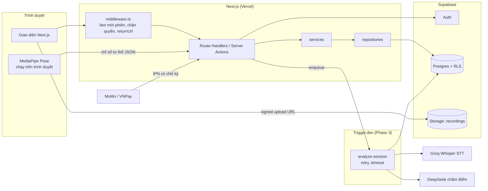
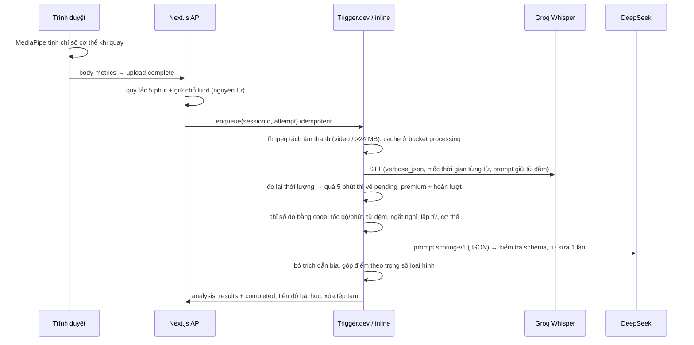
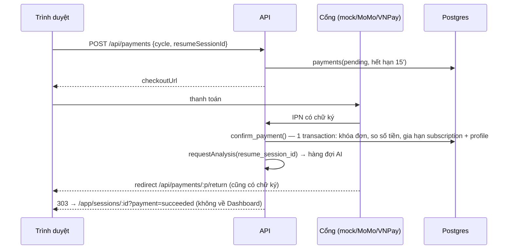

# luyenthuyettrinh.com · Backend

Next.js 15 (App Router) + Supabase (Postgres, Auth, Storage) + Trigger.dev + Groq Whisper + MediaPipe + DeepSeek + MoMo/VNPay.

| Phase | Nội dung | Trạng thái |
|---|---|---|
| 1 | Schema toàn bộ MVP, Auth, hồ sơ, mục tiêu mặc định, chặn quyền truy cập | **Xong** |
| 2 | Tạo buổi luyện, upload Storage, quy tắc > 5 phút, thư viện, lưu trữ 30 ngày, email (Resend/mock), xóa tài khoản | **Xong** |
| 3 | Hàng đợi Trigger.dev/inline, Groq STT, MediaPipe (trình duyệt), LLM chấm điểm, retry/timeout/watchdog, mock cho mọi dịch vụ | **Xong** |
| 4 | Thanh toán mô phỏng (mock) + MoMo/VNPay cắm sẵn, IPN có chữ ký, kích hoạt Premium, tự phân tích bài đang chờ | **Xong** (MoMo/VNPay chờ khóa sandbox) |
| 5 | Khóa học, tiến độ, lộ trình cá nhân hóa | Chưa làm (schema + seed đã có) |
| 6 | So sánh tiến bộ, hoàn thiện xử lý lỗi | Chưa làm |

## Frontend (SPA) + chạy local

Giao diện là SPA tĩnh ở repo `luyenthuyettrinh` (HTML/CSS/JS thuần, hash routing). Backend phục vụ nó **cùng origin** (thư mục `public/`, trang chủ `/` được rewrite tới `public/index.html`), nên cookie phiên Supabase dùng được mà không cần CORS.

```bash
npx supabase start            # Postgres + Auth + Storage + Mailpit (email local: http://127.0.0.1:54324)
cp .env.example .env.local    # điền URL/khóa từ output của `supabase start`
npm run spa:sync              # chép ../luyenthuyettrinh vào public/ (chạy lại sau mỗi lần sửa frontend)
npm run dev                   # http://localhost:3000
```

- Xác thực email và đặt lại mật khẩu dùng **link** (`/auth/confirm?token_hash=...`), không dùng mã 6 số. Mẫu email ở `supabase/templates/`; trên Supabase Cloud phải dán cùng nội dung vào Dashboard → Auth → Email Templates và đặt Site URL.
- Link token_hash chạy được trên mọi thiết bị. Link PKCE mặc định của Supabase thì không (mất cookie verifier khi mở ở máy khác hoặc sau khi bấm "gửi lại").
- Đã nối với backend: đăng ký, đăng nhập, xác thực email, quên/đặt lại/đổi mật khẩu, hồ sơ, mục tiêu, ngôn ngữ, onboarding, gói và lượt dùng (`js/api.js`, `Auth`, `UserStore` trong `js/store.js`).
- Chưa nối (vẫn lưu localStorage): buổi luyện, thư viện, tiến độ khóa học, thanh toán, Google OAuth thật (cần khóa Google).

## 1. Kiến trúc



**Nguyên tắc:**
- Client chỉ được **đọc** dữ liệu của chính mình (RLS).
- Mọi thao tác **ghi** có quy tắc nghiệp vụ (5 phút, lượt phân tích, thanh toán, điểm) đi qua API server dùng `service_role`. Vì vậy không thể lách quy tắc bằng cách gọi thẳng Supabase bằng anon key.
- Riêng `profiles`, người dùng chỉ được tự sửa các cột hồ sơ và tùy chọn, không sửa được `plan` hay `premium_expires_at`.

### Đề xuất điều chỉnh stack (trade-off)

| Hạng mục | Đề xuất | Lý do | Đánh đổi |
|---|---|---|---|
| MediaPipe Pose | Chạy **trên trình duyệt** (`@mediapipe/tasks-vision`) khi quay hoặc xem lại video, gửi chỉ số JSON lên server | Không tốn GPU/CPU server, không phải chạy Python trong Trigger.dev, phản hồi được ngay khi đang quay (nhắc nhở thời gian thực) | Client có thể sửa chỉ số. Chấp nhận được với MVP. Muốn chống gian lận thì thêm worker Python phía server sau |
| Auth | Dùng **Supabase Auth** cho xác thực email, quên mật khẩu, Google, thay vì tự viết | An toàn và ít code | Mẫu email và giới hạn tốc độ cấu hình trên Supabase |
| Gia hạn Premium | **Gói trả trước theo kỳ.** `auto_renew` dùng để nhắc gia hạn và tạo link thanh toán kỳ mới | MoMo/VNPay không hỗ trợ trừ tiền định kỳ nếu không có hợp đồng tokenization riêng | Người dùng phải bấm thanh toán mỗi kỳ |
| Groq Whisper | Giữ nguyên, kèm `prompt` gợi ý từ đệm tiếng Việt | Rẻ và nhanh | Whisper hay tự xóa “ừm”, “à”. Phải đo trên dữ liệu thật ở Phase 3 |

## 2. Database

- Migration: [`supabase/migrations/20261106000001_init_schema.sql`](supabase/migrations/20261106000001_init_schema.sql), [`…002_storage.sql`](supabase/migrations/20261106000002_storage.sql)
- Dữ liệu mẫu: [`supabase/seed.sql`](supabase/seed.sql) gồm 5 khóa, 20 bài, 20 đề bài. File này sinh từ `../luyenthuyettrinh/js/data.js` bằng lệnh `npm run db:seed:gen`, nên frontend và backend dùng chung một nội dung.

| Bảng | Vai trò | Ghi chú chính |
|---|---|---|
| `profiles` | Mở rộng `auth.users` | `default_goal`, `ui_language`, `speaking_language` (độc lập nhau), `onboarded_at`, `plan`, `premium_expires_at`. Hàm `is_premium()`. Tự tạo khi đăng ký (trigger đọc metadata) |
| `usage_counters` | Lượt phân tích theo tháng (giờ VN) | `reserve_analysis_credit()` nguyên tử, `refund_analysis_credit()` khi lỗi. Chỉ server gọi được |
| `library_items` | Tệp ghi âm/video hoặc kịch bản | Ràng buộc: kịch bản không có `storage_path`, tệp bắt buộc có. Xóa mềm bằng `deleted_at` |
| `practice_sessions` | Một lần nộp bài | `status`: draft → uploading → uploaded → (pending_premium \| pending_quota) → queued → processing → completed/failed. `blocked_reason` bắt buộc khi đang chờ |
| `analysis_results` | Kết quả 1-1 với buổi luyện | Điểm, transcript, chỉ số giọng nói/tư thế, feedback (JSONB), model, token, chi phí, `trigger_run_id` |
| `analysis_events` | Nhật ký từng bước của job | Chỉ server đọc, dùng để debug |
| `courses` / `lessons` / `practice_prompts` | Nội dung khóa học và đề bài (song ngữ JSONB) | Công khai khi `is_published` |
| `user_lesson_progress` | Tiến độ từng bài | `status`, `best_score`, `attempts` |
| `subscriptions` | Kỳ Premium | Mỗi người tối đa 1 gói `active` (unique index) |
| `payments` | Giao dịch MoMo/VNPay | `order_code` duy nhất, `(provider, provider_txn_id)` duy nhất để IPN idempotent, **`resume_session_id`** để phân tích lại đúng bài sau khi trả tiền |

Phase 2 thêm migration `20261107000003_library_retention_email.sql`: các cột vòng đời tệp (`media_expires_at`, `media_deleted_at`, `media_delete_reason`, `retention_warned_at`), bucket `processing` cho tệp tạm, bảng `email_messages`.

Kiểm chứng không cần Docker: `npm run db:check` chạy toàn bộ migration và seed trên PGlite, rồi kiểm tra trigger, ràng buộc, lượt phân tích và RLS.

## 3. Cấu trúc thư mục

```
src/
  app/
    api/auth/{register,login,logout,resend-verification,forgot-password,reset-password,oauth/google}/route.ts
    api/me/route.ts · api/me/preferences/route.ts · api/me/onboarding/route.ts · api/health/route.ts
    auth/callback/route.ts (PKCE: email, reset, Google) · auth/confirm/route.ts (token_hash)
    (auth)/{login,register,verify-email,forgot-password,reset-password}/page.tsx   ← trang demo tối giản
    onboarding/ (Server Action) · app/ (layout chặn quyền + onboarding)
  config/plans.ts          giới hạn gói, giá
  lib/                     env, errors (mã lỗi song ngữ), http (handler, validate), logger (JSON), auth, validation
  lib/supabase/            server (RLS) · admin (service_role) · browser · middleware
  repositories/            truy cập DB, không chứa nghiệp vụ
  services/                nghiệp vụ: auth.service, profile.service
  jobs/                    (Phase 3) Trigger.dev tasks
  types/database.ts        kiểu khớp schema
  middleware.ts            chặn quyền + returnUrl + khách/đã đăng nhập
supabase/  config.toml · migrations/ · seed.sql
scripts/   gen-seed.mjs · check-schema.mjs
```

## 4. API endpoints

Định dạng chung: thành công `{ data }`, lỗi `{ error: { code, message, details?, requestId } }`. `message` theo header `x-ui-language`, cookie `ui_lang` hoặc `Accept-Language`.

| Phase | Method | Path | Mô tả |
|---|---|---|---|
| 1 ✅ | POST | `/api/auth/register` | `{fullName,email,password,uiLanguage,defaultGoal?,speakingLanguage?}` → 201 `{needsVerification}` |
| 1 ✅ | POST | `/api/auth/login` | `{email,password,returnUrl?}` → `{me, redirectTo}` (về `/onboarding` nếu chưa thiết lập) |
| 1 ✅ | POST | `/api/auth/logout` | Hủy phiên |
| 1 ✅ | POST | `/api/auth/resend-verification` | Gửi lại email xác thực |
| 1 ✅ | POST | `/api/auth/forgot-password` | Luôn 200, không lộ email nào đã đăng ký |
| 1 ✅ | POST | `/api/auth/reset-password` | Cần phiên khôi phục từ link email |
| 1 ✅ | GET | `/api/auth/oauth/google?next=` | 302 tới Google |
| 1 ✅ | GET | `/auth/callback`, `/auth/confirm` | Nhận link email/OAuth → phiên → chuyển trang |
| 1 ✅ | GET / PATCH | `/api/me` | Hồ sơ, gói, lượt còn lại / sửa tên, tổ chức |
| 1 ✅ | PATCH | `/api/me/preferences` | `uiLanguage`, `speakingLanguage`, `defaultGoal` |
| 1 ✅ | POST | `/api/me/onboarding` | Lưu mục tiêu mặc định + ngôn ngữ bài nói |
| 1 ✅ | GET | `/api/health` | Kiểm tra DB |
| 2 ✅ | POST | `/api/sessions` | `{kind,mimeType,sizeBytes,goal?,speakingLanguage?,promptId?,customTitle?,lessonSlug?,isPlacement?}` → buổi luyện + signed upload URL |
| 2 ✅ | POST | `/api/sessions/:id/upload-complete` | `{durationSec}` → kiểm tra tệp trong Storage, áp quy tắc 5 phút và lượt. Gọi lại an toàn |
| 2 ✅ | POST | `/api/sessions/script` | `{text,...}` nộp kịch bản (≥ 40 từ) |
| 2 ✅ | GET | `/api/library?filter=all\|audio\|video\|script\|pending&q=&before=` | Thư viện có phân trang |
| 2 ✅ | GET / DELETE | `/api/library/:id` | Chi tiết / xóa hẳn bài (tệp + báo cáo) |
| 2 ✅ | GET / DELETE | `/api/library/:id/media?download=1` | Signed URL 5 phút / chỉ xóa video, giữ báo cáo |
| 2 ✅ | GET | `/api/sessions/:id` · POST `/api/sessions/:id/analyze` | Trạng thái / phân tích bài đang chờ hoặc chạy lại |
| 2 ✅ | GET | `/api/public/prompts?goal=` | Bộ đề bài theo loại hình |
| 2 ✅ | DELETE | `/api/me` | `{confirmEmail}` xóa vĩnh viễn tài khoản và dữ liệu |
| 2 ✅ | GET | `/api/cron/retention` | Cron hằng ngày, cần `Authorization: Bearer CRON_SECRET` |
| 3 ✅ | POST | `/api/sessions/:id/body-metrics` | Chỉ số MediaPipe từ trình duyệt (gửi trước `upload-complete`) |
| 4 ✅ | GET | `/api/public/billing` | Cổng đang bật + bảng giá |
| 4 ✅ | GET · POST | `/api/payments` | Lịch sử / `{provider,cycle,resumeSessionId?,returnPath?}` → `checkoutUrl` |
| 4 ✅ | GET · POST | `/api/payments/:id` · `/api/payments/:id/cancel` | Trạng thái (trang quay về hỏi định kỳ) / người dùng đóng cổng thanh toán |
| 4 ✅ | GET/POST | `/api/payments/{mock,momo,vnpay}/ipn` | IPN công khai, xác thực bằng chữ ký, idempotent |
| 4 ✅ | GET | `/api/payments/{mock,momo,vnpay}/return` | Trình duyệt quay về: xác nhận (nếu IPN chưa tới) rồi chuyển về **đúng bài đang chờ** |
| 4 ✅ | POST | `/api/payments/mock/simulate` | Nút Thành công / Thất bại / Hủy của trang `/pay/mock/:id` |
| 5 | GET | `/api/courses`, `/api/courses/:goal`, `/api/lessons/:slug` | Kèm tiến độ và thứ tự cá nhân hóa |
| 5 | POST | `/api/lessons/:slug/read` | Đánh dấu đã đọc lý thuyết |
| 6 | GET | `/api/progress/compare?ids=` | Cần ≥ 3 buổi, trả `NOT_ENOUGH_SESSIONS` kèm số còn thiếu |

## AI pipeline (Phase 3)



- **Phần chia việc:** LLM chỉ chấm *nội dung, cấu trúc, bám chủ đề* (với kịch bản thêm *mở bài, kết bài*) và viết phản hồi. *Tốc độ, từ đệm, độ trôi chảy, cơ thể, độ dài* được đo bằng code, nên ổn định, rẻ và kiểm thử được.
- **Prompt có phiên bản:** [`src/ai/core/prompts/scoring.v1.ts`](src/ai/core/prompts/scoring.v1.ts). Đổi prompt thì tạo `v2` và đổi `PROMPT_VERSION`. Phiên bản được lưu vào `analysis_results` để so sánh chất lượng.
- **Lỗi và thử lại:**
  - Lỗi tạm thời (mạng, 429, 5xx, JSON sai) → thử lại 3 lần với backoff.
  - Lỗi vĩnh viễn (`NO_SPEECH`, `AUDIO_UNREADABLE`, `MEDIA_MISSING`) → dừng ngay.
  - Thất bại hẳn → `failed` và **hoàn lượt**.
  - Quá 10 phút → `TIMEOUT`.
  - Watchdog chạy mỗi 15 phút, gỡ các bài kẹt quá 45 phút.
- **Mock:** thiếu khóa Groq, DeepSeek hoặc Trigger.dev thì tự dùng bản mô phỏng ([`src/ai/core/mock.ts`](src/ai/core/mock.ts)). Bản mô phỏng cho kết quả xác định, đi qua cùng đường xử lý thật. Kết quả ghi rõ `stt_model = mock-stt`, `llm_model = mock-llm`.
- **MediaPipe** chạy trên trình duyệt: [`src/client/body-language/tracker.ts`](src/client/body-language/tracker.ts) dùng FaceLandmarker (hướng nhìn, nụ cười) và PoseLandmarker (cử chỉ tay, nghiêng vai, đung đưa).
- **Theo dõi:** bảng `analysis_events` ghi từng bước của job. Trigger.dev Dashboard xem được từng run.

**Chạy Trigger.dev local:** điền `TRIGGER_PROJECT_ID` và `TRIGGER_SECRET_KEY`, chạy `npx trigger.dev@4.7.7 dev` song song với `npm run dev`. Deploy bằng `npx trigger.dev@4.7.7 deploy`. Nhớ đặt các biến Supabase, Groq và DeepSeek trong Trigger.dev Dashboard.

## Thanh toán (Phase 4)



- **Một interface `Gateway`** (`src/payments/gateways.ts`): `createCheckout`, `verify`, `ipnReply`. Service không rẽ nhánh theo cổng. Logic ký/kiểm chữ ký thuần ở `src/payments/core.ts` (VNPay HMAC-SHA512, MoMo HMAC-SHA256, mock HMAC-SHA256), có unit test.
- **Mock** đi đúng đường của cổng thật: trang `/pay/mock/:id` → ký payload → cùng hàm verify → `confirm_payment` → redirect có chữ ký. Bật MoMo/VNPay chỉ cần điền khóa vào env; đặt `PAYMENT_MOCK_ENABLED=false` ở production khi đã có cổng thật.
- **Idempotent**: IPN lặp, IPN + return cùng lúc đều chỉ kích hoạt 1 lần (khóa hàng `for update`, unique `(provider, provider_txn_id)`). Thất bại/hủy không ghi đè thành công; tiền đã trừ thì luôn được ghi nhận kể cả khi đơn đã hết hạn/bị thay thế. Sai số tiền → không kích hoạt, log `AMOUNT MISMATCH` để xử lý tay.
- **Gia hạn sớm** cộng dồn lên kỳ hiện tại. Cron hằng ngày gọi `expire_billing()`: đơn treo → expired, gói hết hạn → về Miễn phí.
- **Tự phân tích sau thanh toán** chỉ chạy khi bài đang ở `pending_premium`/`pending_quota`, nên gọi lại nhiều lần không chạy lại hay trừ lượt hai lần. Nếu xếp hàng lỗi, thanh toán vẫn giữ, trang bài hiện nút "Phân tích ngay".

## 5. Chạy local

Cần Docker (cho Supabase local) và Node 20 trở lên.

```bash
npm install
npx supabase start            # in ra API URL, anon key, service_role key
cp .env.example .env.local    # điền 3 giá trị Supabase vừa in ra
npx supabase db reset         # chạy migrations + seed.sql
npm run dev                   # http://localhost:3000
```

- Email xác thực và đặt lại mật khẩu khi chạy local: xem tại Inbucket http://127.0.0.1:54324
- Kiểm tra schema không cần Docker: `npm run db:check`
- Kiểm tra code: `npm run typecheck && npm test && npm run build`

**Checklist biến môi trường Phase 1:** `NEXT_PUBLIC_SITE_URL`, `NEXT_PUBLIC_SUPABASE_URL`, `NEXT_PUBLIC_SUPABASE_ANON_KEY`, `SUPABASE_SERVICE_ROLE_KEY`. Tùy chọn: Google OAuth. Các biến của phase sau đã liệt kê sẵn trong [.env.example](.env.example).

**Trên Supabase Cloud cần đặt:**
- Auth → URL Configuration: Site URL và Redirect URLs `https://<domain>/auth/callback`, `/auth/confirm`.
- Auth → Providers → Email: bật "Confirm email". Mật khẩu tối thiểu 8 ký tự, yêu cầu có chữ và số.
- Cấu hình SMTP riêng (Resend, SES…). Email mặc định của Supabase chỉ gửi được vài email mỗi giờ.

## 6. Chi phí và bảo mật

**Chi phí (MVP):**
- Supabase Free: 500 MB database, 1 GB Storage. Video chiếm dung lượng nhanh, nên nén ở client (720p trở xuống) và đặt chính sách xóa bản ghi cũ hoặc nâng gói Pro.
- Groq Whisper tính theo giờ âm thanh, rẻ. Chỉ gửi âm thanh (tách khỏi video ở client) để giảm dung lượng tải lên.
- LLM chỉ nhận transcript và chỉ số dạng JSON, không nhận video, nên mỗi bài chỉ vài nghìn token. Ghi `input_tokens`, `output_tokens`, `cost_usd` vào `analysis_results` để theo dõi chi phí thật.
- MediaPipe chạy trên trình duyệt nên không tốn chi phí server.

**Bảo mật:**
- RLS trên mọi bảng. `service_role` chỉ dùng ở server (`import 'server-only'`).
- Không ghi trực tiếp từ client vào bảng có quy tắc nghiệp vụ.
- `returnUrl` và `next` chỉ chấp nhận đường dẫn nội bộ, chống open redirect.
- Quên mật khẩu không tiết lộ email nào đã đăng ký.
- Middleware dùng `getUser()` (xác minh JWT với Auth server) thay vì chỉ đọc cookie.
- Log dạng JSON có `requestId`, email được che bớt.
- Đã nâng `next` lên 15.5.28 vì 15.3.x dính CVE-2025-66478, và ép bản vá cho `postcss`, `sharp`. `npm audit` hiện báo 0 lỗ hổng.
- Phase 4: IPN chỉ tin chữ ký HMAC (so sánh timing-safe), so khớp số tiền, idempotent; `confirm_payment`/`expire_billing` chỉ service_role gọi được; người dùng không tự sửa được `plan`.
- Cổng mock cho phép ai đăng nhập cũng "mua" Premium miễn phí — chấp nhận được cho bản demo, **phải tắt** (`PAYMENT_MOCK_ENABLED=false`) trước khi thu tiền thật.
